# Informe — Landing page de Ingeniería en Informática UTEM

| | |
|---|---|
| **Asignatura** | EFE685 — Electivo de Computación Móvil |
| **Profesor** | Sebastián Salazar Molina |
| **Integrantes** | Felipe Velasquez · Ernesto Baltierra |
| **Carrera** | Ingeniería en Informática, Universidad Tecnológica Metropolitana |
| **Sitio publicado** | https://sitiocompumovil.netlify.app |
| **Repositorio** | https://github.com/ffvela/CompuMovil |
| **Fecha** | Noviembre de 2026 |

---

## 1. Qué hicimos, en una página

**Lo que queríamos hacer.** Una página de una sola vista que ayude a estudiantes de 3.° y 4.° medio, a sus familias y a personas de 20 años o más a decidir si estudiar Ingeniería en Informática en la UTEM, sin frases publicitarias y con cada dato respaldado por una fuente oficial.

**Las bases.** Revisamos 12 fuentes (11 primarias): la página oficial de la carrera, Mi Futuro, el DEMRE, la acreditación de la UTEM y las fichas de 3 carreras afines. Además, encuestamos a 6 personas del público objetivo.

**Los fundamentos.** Cada decisión del sitio sale de esas bases:

- **El orden de las secciones** sale de la encuesta. "En qué voy a trabajar y cuánto se gana" fue lo más pedido (5 de 6), por eso el Campo laboral va tercero.
- **Las preguntas frecuentes** salen de las barreras que mencionó la gente: el puntaje, el costo, las matemáticas y "no saber si me va a gustar".
- **Cada cifra** muestra su año y una cita que lleva a la sección Referencias.
- **En el sitio se distingue** con etiquetas qué es dato oficial, qué es interpretación nuestra y qué es opinión personal.
- **En lo técnico**, todo el contenido vive en archivos JSON validados con esquemas. Si un dato no tiene fuente o queda un pendiente, el sitio no se publica.

**Lo que aprendimos en el camino.** Revisar las fuentes con cuidado cambió el sitio varias veces:

- Dos enlaces oficiales dejaron de funcionar.
- La UTEM publica dos mallas distintas (una es del plan anterior).
- La acreditación cambió de 4 a 5 años en octubre de 2026, y Mi Futuro todavía no lo refleja.

Contamos estas correcciones en la sección 7 (Validación).

---

## 2. Fase A — Fuentes

Priorizamos fuentes primarias. Cada una la evaluamos con cinco criterios: autoridad, vigencia, trazabilidad, objetividad y pertinencia. La matriz completa está en el **Anexo A**.

Decisiones importantes:

- **Malla:** usamos la página oficial de la carrera (F01) y no el folleto PDF (F03). El folleto se subió en 2026, pero muestra el plan anterior: su malla es igual a la del folleto de 2023.
- **Empleabilidad:** usamos Mi Futuro (F05) y no el folleto, porque el folleto no dice de qué año son sus cifras.
- **Comparación con un instituto profesional:** usamos Mi Futuro para la UTEM y para Duoc UC (F05 y F09). Así los indicadores son los mismos y la comparación es justa.
- **Acreditación:** usamos la noticia oficial de la UTEM (octubre de 2026), porque informa la resolución más reciente. No encontramos la resolución en el sitio de la CNA; lo declaramos como limitación.
- **Fuentes descartadas:** F02 (resolución del plan 2022), F03 (folleto con el plan anterior) y F10 (estudio de 2023). Las dejamos en la matriz para mostrar por qué no se usaron.

---

## 3. Fase B — Audiencia

### 1. Instrumento y participantes

- **Instrumento:** cuestionario en Google Forms con 9 preguntas, una de consentimiento y 8 de contenido (ver Anexo: pantallazo o exportación de las preguntas del formulario).
- **Fecha de aplicación:** 13 y 14 de noviembre de 2026.
- **Respuestas:** 6.
- **Consentimiento:** las 6 personas marcaron "Leí la información y acepto participar". El archivo original con las respuestas se guarda para que el profesor lo revise y no se publica.

| Código | Perfil |
|---|---|
| P1 | Estudiante de 4.° medio |
| P2 | Terminó la enseñanza media y está buscando carrera |
| P3 | Persona de 20 años o más que piensa cambiarse de carrera o empezar una |
| P4 | Estudiante de 4.° medio |
| P5 | Estudiante de 3.° medio |
| P6 | Familiar de alguien que va a postular |

Cuatro participantes son del público principal (P1, P4 y P5 como estudiantes, y P6 como familiar), uno es del público secundario (P3) y uno está recién egresado de la enseñanza media (P2).

### 2. Resultados

#### ¿Has considerado estudiar Ingeniería en Informática o una carrera parecida?

| Respuesta | Frecuencia |
|---|---|
| Tal vez | 3 de 6 |
| Sí | 2 de 6 |
| No | 1 de 6 |

La mitad de las personas todavía no está segura. Esto coincide con la barrera "No saber si me va a gustar" y refuerza la decisión de explicar qué es la carrera antes que lo demás.

#### ¿Qué te gustaría saber de una carrera antes de postular? (varias opciones)

| Prioridad | Tema | Frecuencia |
|---|---|---|
| 1 | En qué podría trabajar y cuánto se gana | 5 de 6 |
| 2 | Qué ramos tiene y cómo es la malla | 4 de 6 |
| 2 | Cómo postular y qué puntaje necesito | 4 de 6 |
| 2 | Becas, gratuidad o financiamiento | 4 de 6 |
| 5 | Si la carrera o la universidad está acreditada | 2 de 6 |
| 5 | Qué es y en qué se diferencia de carreras parecidas | 2 de 6 |
| 7 | Duración y horario | 1 de 6 |

En la pregunta "¿Cuál es la MÁS importante?", empataron "En qué podría trabajar" y "Qué ramos tiene" (2 de 6 cada una).

#### ¿Qué podría frenarte de postular?

| Barrera | Frecuencia |
|---|---|
| El puntaje | 4 de 6 |
| No saber si me va a gustar | 3 de 6 |
| El costo | 3 de 6 |
| Las matemáticas | 2 de 6 |
| La distancia o el traslado | 1 de 6 |

#### Dudas o miedos (respuesta abierta)

- "Complejidad" (P1)
- Miedo a no ser lo bastante bueno en matemáticas (P3)
- "Si realmente me gusta lo que estudiaré" (P4)
- "Empleabilidad a futuro" (P5)
- Dos personas no mencionaron dudas (P2 y P6).

#### Canales y dispositivo

| Canal | Frecuencia |
|---|---|
| Google | 5 de 6 |
| Sitio web de la universidad | 4 de 6 |
| Ferias | 4 de 6 |
| Inteligencia artificial (ChatGPT u otra) | 3 de 6 |
| YouTube / TikTok | 2 de 6 cada uno |

De las tres personas que indicaron dispositivo, dos usan principalmente el celular y dos el computador (una marcó ambos).

### 3. Perfil de usuario (persona)

> Persona construida a partir de las respuestas; no corresponde a un participante real.

**Valentina, 17 años, estudiante de 4.° medio**

- **Contexto:** le gusta la tecnología, pero no está segura de qué estudiar. Va a rendir la PAES a fin de año y su familia le ayuda a revisar opciones.
- **Preguntas principales:** en qué podría trabajar y cuánto se gana; qué ramos tiene la carrera; qué puntaje necesita; si hay gratuidad o becas.
- **Dudas:** si de verdad le va a gustar y si las matemáticas le van a costar demasiado.
- **Barreras:** el puntaje, el costo y no saber si la carrera es para ella.
- **Canal de llegada:** busca en Google y en los sitios de las universidades, va a ferias y a veces le pregunta a una inteligencia artificial. Revisa desde el celular y desde el computador.

**Perfil secundario (persona de 20 años o más):** está pensando en empezar o cambiarse de carrera. Le preocupa no tener la base de matemáticas, el traslado y el financiamiento. Le importa más la malla que la vida universitaria.

### 4. Decisiones que tomamos con estos datos

| Hallazgo | Decisión en el sitio |
|---|---|
| "En qué trabajaré y cuánto se gana" es lo más pedido (5 de 6) | Campo laboral sube al tercer lugar, justo después de la portada y de "Sobre la carrera" |
| Malla, admisión y financiamiento empatan (4 de 6) | Plan de estudios va en el 4.º lugar, y Admisión incluye los costos y la Gratuidad |
| La mitad aún no decide si estudiaría algo parecido ("Tal vez", 3 de 6) | Se refuerza la ubicación de "Sobre la carrera" en segundo lugar |
| La acreditación interesa menos (2 de 6) | Respaldo institucional baja después de Admisión |
| "No saber si me va a gustar" (3 de 6) | "Sobre la carrera" se mantiene arriba, con testimonios sobre los ramos que más nos gustaron |
| Miedo a las matemáticas (2 de 6, más una respuesta abierta) | Pregunta frecuente con el número real de ramos de ciencias básicas |
| El puntaje es la barrera principal (4 de 6) | Ponderaciones y puntaje mínimo visibles en Admisión, más una pregunta frecuente |
| Google es el canal principal (5 de 6) | Cuidamos el SEO: título, descripción y sitemap |
| 3 de 6 buscan información con IA | Agregamos un archivo `llms.txt` con el resumen de la carrera |
| Uso parejo de celular y computador | Diseño responsivo probado en 360, 768 y 1280 px |

### 5. Limitaciones

- La muestra es pequeña (6 personas) y por conveniencia (conocidos del equipo), así que los resultados orientan, pero no representan a todos los postulantes.
- El formulario no preguntó si los participantes menores de edad contaban con la autorización de su apoderado.
- El formulario pedía el primer nombre y algunas personas escribieron su nombre completo. En este informe usamos solo códigos.

El instrumento aplicado y los resultados completos están en el **Anexo B**.

---

## 4. Fase C — Arquitectura de información

### 4.1 Orden de las secciones

El orden lo definimos con los resultados de la encuesta de la Fase B (6 respuestas).

| # | Sección (ancla) | Pregunta que responde | Por qué va en este lugar | Evidencia (Fase B) | Fuentes |
|---|---|---|---|---|---|
| 1 | Portada `#inicio` | ¿Qué es la carrera? | Es lo primero que se ve: nombre, título, duración y un acceso directo a Admisión. | — | F01, F06 |
| 2 | Sobre la carrera `#sobre` | ¿En qué se diferencia? | Aunque solo 2 de 6 lo marcaron, 3 de 6 temen que "no les guste". Por eso explicamos qué es la carrera antes que lo demás. | "No saber si me va a gustar" 3/6; "diferencia" 2/6 | F01, F05, F07, F08, F09 + interpretación del equipo |
| 3 | Campo laboral `#trabajo` | ¿Dónde trabajaré? | Es lo que más quiere saber el público. | "En qué podría trabajar y cuánto se gana" 5/6 | F01, F05, F12 |
| 4 | Plan de estudios `#malla` | ¿Qué aprenderé? | Empata en segundo lugar y es una de las dos opciones "más importantes". | "Qué ramos tiene" 4/6 | F01 |
| 5 | Perfil de egreso `#perfil` | ¿Qué podré hacer? | Va pegado a la malla porque la complementa: de lo que estudias a lo que sabrás hacer. | — | F01 |
| 6 | Admisión y costos `#admision` | ¿Cómo postulo? ¿Cuánto cuesta? | El puntaje es la barrera principal, y el financiamiento empata en segundo lugar. | "Cómo postular" 4/6; "Becas, gratuidad" 4/6; barrera "puntaje" 4/6; barrera "costo" 3/6 | F01, F06 |
| 7 | Respaldo institucional `#respaldo` | ¿Qué garantías hay? | Es lo que menos interesó, pero es obligatorio y confirma la decisión. | "Acreditación" 2/6 | F01, F04, F12 |
| 8 | Preguntas frecuentes `#faq` | Dudas reales | 8 preguntas que salen de las barreras y dudas de la encuesta. | Barreras y respuestas abiertas | Según cada respuesta |
| 9 | Referencias `#referencias` | ¿De dónde sale esto? | Va al final, como en un informe. | — | Todas |

**Canal de llegada:** Google (5/6) y los sitios de las universidades (4/6) justifican cuidar el SEO. Que 3 de 6 busquen con IA justifica agregar `llms.txt`. El uso parejo de celular y computador justifica un diseño responsivo pensado primero para móvil.

**Testimonios "de estudiante a estudiante":** son recuadros dentro de las secciones 2, 3, 4 y 7, y de las preguntas frecuentes, marcados como "Opinión personal".

### 4.2 Wireframes

Hicimos los wireframes **antes** de tener los resultados de la encuesta, con un orden provisional (versión 1). Cuando llegaron los datos, reordenamos las secciones en el sitio final (versión 2): Campo laboral subió y Admisión quedó antes de Respaldo. Dejamos la versión 1 como evidencia de cómo cambió el diseño.

| Móvil (360 px) | Escritorio (1280 px) |
|---|---|
| 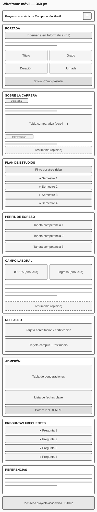 | 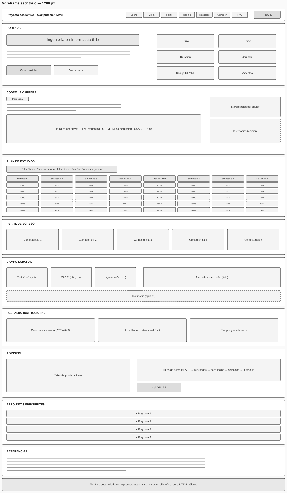 |

### 4.3 Diseño visual

#### Colores (Manual de Identidad Visual UTEM, 2025)

| Uso | Color | HEX | Contraste |
|---|---|---|---|
| Fondo | Blanco | #FFFFFF | — |
| Texto principal y fondos oscuros | Azul complementario | #0B2341 | Muy alto sobre blanco |
| Enlaces, botones y títulos | Azul UTEM | #004EAA | 7,86:1 sobre blanco (cumple AA) |
| Texto y etiquetas en verde | Verde accesible (mismo tono que el verde UTEM, más oscuro) | #3F6B12 | 6,3:1 sobre blanco (cumple AA) |
| Solo decoración (bordes, líneas, fondo de etiquetas con texto oscuro encima) | Verde UTEM original | #78BF26 | 2,26:1 sobre blanco (no cumple como texto); 6,97:1 con texto #0B2341 encima (cumple) |

**Decisión de accesibilidad:** el verde institucional #78BF26 no alcanza el contraste mínimo de 4,5:1 que exige WCAG 2.2 AA para texto sobre blanco (da 2,26:1). Por eso creamos una variante más oscura del mismo tono (#3F6B12, 6,3:1) para todo lo que sea texto, y el verde original quedó solo para elementos decorativos. Los contrastes los calculamos con la fórmula de luminancia relativa de WCAG.

#### Tipografía
El manual de la UTEM acepta Montserrat y Open Sans, pero decidimos usar las fuentes del sistema (`system-ui`). Así no se descarga ninguna tipografía y la página carga más rápido, lo que mejora el puntaje de Rendimiento en Lighthouse.

#### Lo que tomamos del sitio de ejemplo del profesor
- Enlace "Saltar al contenido" (accesibilidad, navegación con teclado).
- Un solo `<h1>`, un `<h2>` por sección y `<h3>` en las tarjetas (jerarquía de encabezados).
- `aria-hidden` en los elementos decorativos. El sitio no tiene fotos; si se agregan, deben ir con `<Image>` de `astro:assets` y un texto alternativo descriptivo.
- `target="_blank"` siempre acompañado de `rel="noopener noreferrer"`.
- Layout base con `<head>`, Open Graph y `lang="es-CL"` (SEO).
- Todo lo demás (estética, componentes, textos) es diseño propio.

---

## 5. Fase D — Redacción

Seguimos esta guía de estilo:

- Oraciones de menos de 25 palabras. Lo revisamos con un script: ninguna oración de los textos supera ese límite.
- Cada sigla se escribe completa la primera vez: PAES, CNA, SCT, DEMRE, CONAIC.
- Cada cifra lleva su año y una **cita breve estilo APA** (por ejemplo, *(SIES, 2026)*), enlazada a su entrada en Referencias.
- Cada bloque de texto lleva una etiqueta visible: **Dato oficial**, **Interpretación del equipo** u **Opinión personal**. Las etiquetas combinan texto y color, para no depender solo del color.
- Los textos están en `src/content/*.json`, separados por sección y por tipo de colección.

**Testimonios.** Son la experiencia real de los dos integrantes del equipo, publicada con su nombre y su autorización (Anexo D). Solo corregimos la ortografía. Una pregunta que no supimos responder ("¿qué le dirías a alguien que duda entre esta carrera y Civil en Computación?") no la inventamos: esa comparación aparece como interpretación del equipo, basada en las fichas oficiales.

**Datos honestos.** Publicamos que la duración real promedio es de 12,9 semestres, aunque la formal es de 8. También explicamos que la comparación con Duoc es aproximada, porque Mi Futuro agrupa su carrera con otra especialidad.

---

## 6. Implementación

| Decisión | Por qué |
|---|---|
| **Astro, sin otros frameworks** | El sitio es informativo y casi no necesita interactividad. Astro genera HTML estático y no envía JavaScript, salvo donde lo pedimos. |
| **TypeScript en modo strict** | Hereda `astro/tsconfigs/strict`. Todas las props, funciones y esquemas tienen tipos explícitos, y no usamos `any`. |
| **Colecciones de contenido con esquema** (`src/content.config.ts`) | Separan el contenido del código. Los esquemas además **hacen fallar el build** si una cita apunta a una fuente que no existe, si una cifra no tiene año, si las ponderaciones no suman 100 % o si queda un `TODO`. Así el principio "ningún dato sin fuente" no depende de que nos acordemos. |
| **Un componente por sección** + `BaseLayout.astro` | Cada sección es un archivo, y el layout concentra el `<head>`, el SEO, la barra superior y el pie. |
| **CSS propio con variables** (sin Tailwind) | Hay menos dependencias y menos código que documentar, y el CSS pesa pocos KB, así que lo incrustamos en el HTML (`inlineStylesheets`). |
| **Una sola isla interactiva: el filtro de la malla** | Responde al miedo a las matemáticas (2 de 6 en la encuesta), porque muestra de un vistazo que son 9 de 38 ramos y que están en los primeros 4 semestres. Es mejora progresiva: sin JavaScript, la malla se ve completa. |
| **Acordeones nativos** (`
`) en las preguntas frecuentes y en el menú móvil | Funcionan con teclado y no necesitan JavaScript. |
| **Sitemap generado a mano** (`pages/sitemap.xml.ts`) | El sitio tiene una sola página, así que no se justifica instalar una integración. |
| **`llms.txt`** | 3 de 6 encuestados buscan información sobre carreras con inteligencia artificial. Este archivo les entrega un resumen fiel con las fuentes. |
| **Fuentes del sistema** (sin descargar tipografías) | Mejoran el rendimiento. |
| **Despliegue en Netlify** | Se conecta al repositorio y publica solo con cada cambio en `main`. No requiere configurar una ruta base, como sí exige GitHub Pages. |

### 6.1 Accesibilidad (WCAG 2.2 AA)

- Enlace "Saltar al contenido", un solo `<h1>`, un `<h2>` por sección y `lang="es-CL"`.
- Contrastes calculados con la fórmula de WCAG: azul UTEM 7,86:1; verde de texto 6,3:1. El verde original (2,26:1) se usa solo como decoración.
- Tablas con `<caption>`, `scope` y desplazamiento horizontal accesible con teclado.
- El filtro usa `aria-pressed` y anuncia el resultado con `aria-live`.
- Las áreas táctiles miden al menos 44 px, el foco es visible y se respeta `prefers-reduced-motion`.
- Los enlaces externos usan `rel="noopener noreferrer"` y avisan que se abren en una pestaña nueva.

### 6.2 Resultados de calidad

| Herramienta | Rendimiento | Accesibilidad | Buenas prácticas | SEO |
|---|---|---|---|---|
| PageSpeed / Lighthouse (móvil) | 100 | 100 | 100 | 100 |
| PageSpeed / Lighthouse (escritorio) | 100 | 100 | 100 | 100 |
| CompliaScan | Puntaje: 92 / 100 (*Good*) | | | |

Las cuatro categorías de Lighthouse llegaron a 100, tanto en celular como en computador, y CompliaScan dio 92, por sobre el mínimo de 90 que pide el enunciado. Las mediciones se hicieron el 14 de noviembre de 2026 sobre https://sitiocompumovil.netlify.app.

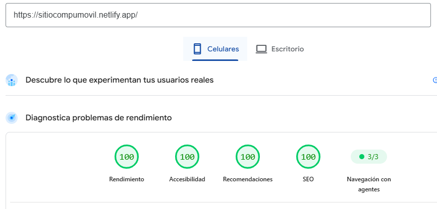

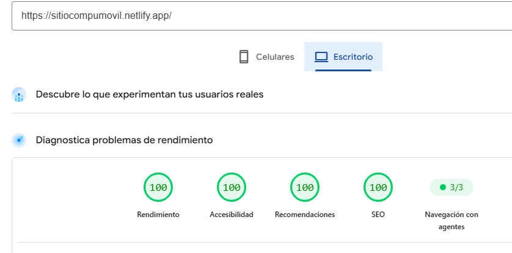

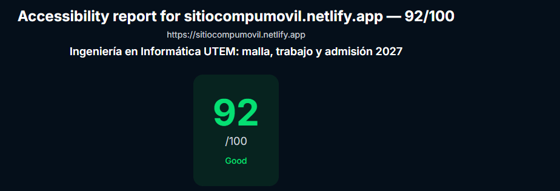

**Diseño responsivo.** Revisamos la página publicada en los tres anchos que pide el enunciado, con la vista de dispositivo de Chrome. En 360 px el menú se convierte en un botón desplegable y todo queda en una columna; en 768 px los datos de la portada pasan a una segunda columna; y en 1280 px se muestra el menú completo arriba.

| 360 px (celular) | 768 px (tablet) | 1280 px (computador) |
|---|---|---|
| 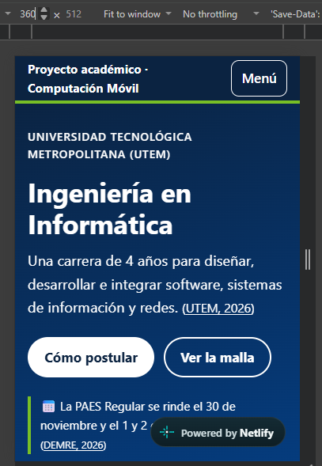 | 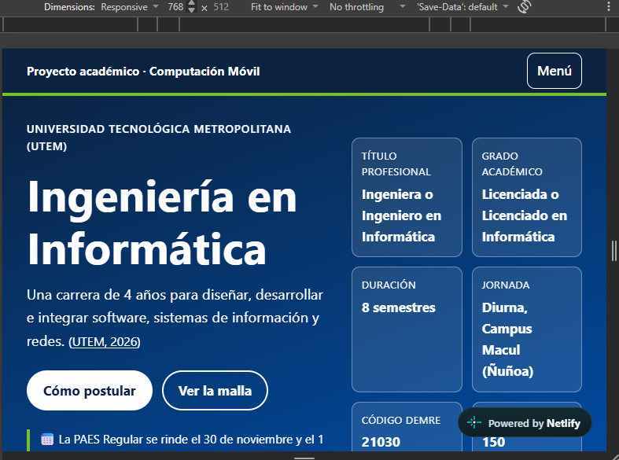 | 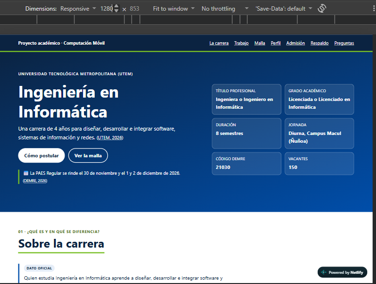 |

---

## 7. Fase E — Validación

Antes de publicar revisamos cada afirmación del sitio contra su fuente. Estos son los problemas que encontramos y cómo los corregimos:

| Afirmación revisada | Hallazgo | Corrección aplicada |
|---|---|---|
| Datos de la ficha de carrera (2023) | El enlace del folleto de 2023 dejó de funcionar | Usamos la página oficial de 2026 (F01) |
| Malla curricular | El folleto de 2026 y la página web muestran mallas distintas. Comparándolos con el folleto de 2023, vimos que el PDF trae el plan anterior | El sitio usa la malla nueva de la página web |
| Acreditación institucional | Una noticia de abril decía 4 años (hasta 2030). En octubre, la CNA acogió una reposición y la subió a 5 años (hasta 2031). Mi Futuro y Wikipedia siguen diciendo 4 | Publicamos 5 años, citando la fuente más reciente |
| Empleabilidad | El folleto (89,6 %) y Mi Futuro (87,1 %) no coinciden, y el folleto no indica el año | Usamos Mi Futuro, que es la fuente primaria y tiene año |
| Comparación con un IP | Los folletos de Duoc no se podían rastrear (uno estaba en un dominio de pruebas) | Usamos Mi Futuro para ambas instituciones |

---

## 8. Conclusiones

Lo que más nos costó en este proyecto no fue programar, sino encontrar datos que estuvieran vigentes: varias veces una fuente oficial estaba desactualizada o contradecía a otra, como pasó con la malla, la acreditación y la empleabilidad, y tuvimos que comparar fuentes para decidir cuál usar. La encuesta también cambió cosas que habíamos dado por hechas, porque el campo laboral terminó subiendo en la página cuando vimos que era lo que más quería saber la gente, y las preguntas frecuentes salieron directo de sus dudas. Por último, armar el contenido con esquemas nos sirvió para que la regla de "ningún dato sin fuente" no dependiera de acordarnos, sino que la revisara el propio build cada vez que se publica la página.

---

## Anexo A — Matriz de fuentes

### Tabla A1 — Identificación de las fuentes

| ID | Referencia (APA 7) | Tipo | Fecha del dato | Fecha de consulta | Sección del sitio |
|---|---|---|---|---|---|
| F01 | Universidad Tecnológica Metropolitana. (2026). *Ingeniería en Informática* [Página de la carrera]. https://www.utem.cl/carreras/ingenieria-en-informatica/ | Primaria | 2026 | 2026-11-13 | Portada, Plan de estudios, Perfil de egreso, Campo laboral, Respaldo, Admisión |
| F02 | Universidad Tecnológica Metropolitana. (2022). *Resolución que aprueba el rediseño de la carrera de Ingeniería en Informática (21030), Plan Regular*. https://transparencia.utem.cl/27oe | Primaria | 2022 | 2026-11-13 | Ninguna (solo en el informe, como antecedente) |
| F03 | Universidad Tecnológica Metropolitana. (2026). *Ingeniería en Informática* [Folleto de la carrera]. https://www.utem.cl/wp-content/uploads/2026/05/INGENIERIA_EN_INFORMATICA_UTEM.pdf | Primaria | 2026 | 2026-11-13 | Ninguna (descartada) |
| F04 | Universidad Tecnológica Metropolitana. (2026, 18 de octubre). *UTEM acreditada Nivel Avanzado*. https://noticias.utem.cl/2026/10/18/utem-acreditada-nivel-avanzado/ | Primaria | 2026 | 2026-11-13 | Respaldo institucional |
| F05 | Servicio de Información de Educación Superior. (2026). *Buscador de empleabilidad e ingresos: Ingeniería en Informática, Universidad Tecnológica Metropolitana* [Base de datos]. Mi Futuro, Ministerio de Educación. https://www.mifuturo.cl/ | Primaria | 2026 | 2026-11-13 | Campo laboral, Preguntas frecuentes |
| F06 | Departamento de Evaluación, Medición y Registro Educacional. (2026). *Fechas importantes PAES Regular, Proceso de Admisión 2027* [Afiche]. https://portaldemre.demre.cl/portales/colegios/material-grafico/03-afiche-p2027-fechas.pdf | Primaria | 2026 | 2026-11-13 | Admisión |
| F07 | Universidad Tecnológica Metropolitana. (2026). *Ingeniería Civil en Computación mención Informática* [Página de la carrera]. https://www.utem.cl/carreras/ingenieria-civil-en-computacion-mencion-informatica/ | Primaria | 2026 | 2026-11-13 | Sobre la carrera |
| F08 | Universidad de Santiago de Chile. (2025). *Ingeniería Civil en Informática* [Ficha de carrera]. https://informatica.usach.cl/wp-content/uploads/2025/03/16004_ING-CIVIL-EN-INFORMATICA_WEB.pdf | Primaria | 2025 | 2026-11-13 | Sobre la carrera |
| F09 | Servicio de Información de Educación Superior. (2026). *Buscador de empleabilidad e ingresos: Ingeniería en Informática, en Infraestructura y Plataformas Tecnológicas, IP Duoc UC* [Base de datos]. Mi Futuro, Ministerio de Educación. https://www.mifuturo.cl/ | Primaria | 2026 | 2026-11-14 | Sobre la carrera |
| F10 | Universidad Tecnológica Metropolitana. (2024). *Empleabilidad de las y los titulados de la UTEM 2023* (Serie Análisis Institucional UTEM). https://calidad.utem.cl/wp-content/uploads/2025/03/2023-Empleabilidad-Tituladosas-UTEM-OP.pdf | Primaria | 2023 | 2026-11-13 | Ninguna (descartada: datos de 2023, reemplazados por F05) |
| F11 | Mediabanco. (2026, 15 de octubre). *Histórico: UTEM acreditada por cinco años con investigación*. https://www.mediabanco.com/historico-utem-acreditada-por-cinco-anos-con-investigacion/ | Secundaria | 2026 | 2026-11-13 | Ninguna en el sitio; solo contexto en el informe |
| F12 | Universidad Tecnológica Metropolitana. (2025). *Resumen ejecutivo: Informe de Autoevaluación Institucional 2025*. https://calidad.utem.cl/wp-content/uploads/2025/10/Resumen-Ejecutivo-Informe-Autoevaluacion-Institucional-2025-2.pdf | Primaria | 2025 | 2026-11-13 | Respaldo, Campo laboral |

### Tabla A2 — Evaluación con los cinco criterios

| ID | Autoridad | Vigencia | Trazabilidad | Objetividad | Pertinencia |
|---|---|---|---|---|---|
| F01 | Cumple. Es la página oficial de la carrera, publicada por la misma UTEM. | Cumple. Está actualizada a 2026: trae vacantes, ponderaciones y la certificación vigente hasta 2030. | Cumple. Es una página pública. Antes usábamos el folleto de 2023, pero ese enlace dejó de funcionar y lo cambiamos por esta página. | Cumple a medias. Tiene partes promocionales, pero solo usamos datos duros (título, ponderaciones, arancel, certificación). | Responde P1, P2, P3, P4 y P5. Es la única fuente que trae la malla actualizada en 2026. |
| F02 | Cumple. Es la resolución que aprobó el Consejo Superior. | No cumple. Aprueba el plan de 2022, y la malla se actualizó en 2026. La dejamos en la matriz para explicar por qué no la usamos. | Cumple. Portal de transparencia. | Cumple. Documento administrativo. | Ya no responde P2 para los postulantes de 2027. |
| F03 | Cumple. Es el folleto oficial de la carrera. | No cumple. Su malla es la del plan anterior y sus cifras de empleabilidad (89,6 % y 95,3 %) no dicen de qué año son. | Cumple. PDF público. | Cumple a medias. Es un folleto. | La descartamos: para la malla usamos F01 y para la empleabilidad, F05. |
| F04 | Cumple a medias. La publica la UTEM y no la CNA, pero es la institución acreditada informando su propia resolución. No encontramos la resolución en el sitio de la CNA. | Cumple. Es de octubre de 2026 e informa el resultado del recurso de reposición, que subió la acreditación de 4 a 5 años. Otras páginas, como Wikipedia, todavía dicen 4 años. | Cumple. Página pública. | Cumple a medias. Es una noticia institucional, pero solo usamos los datos de la resolución (años, nivel, áreas, vigencia). | Responde P4. |
| F05 | Cumple. Mi Futuro es del Mineduc y usa los datos del SIES. Es la fuente oficial de empleabilidad. | Cumple. Son los datos publicados en 2026. Ojo: el buscador todavía muestra 4 años de acreditación, porque no se ha actualizado con la reposición de octubre (ver F04). | Cumple a medias. Es un buscador; anotamos los filtros (Universidades → UTEM → Ingeniería en Informática) y guardamos un pantallazo. | Cumple. Son estadísticas. | Responde P3. También aporta la duración real (12,9 semestres), que usamos en las preguntas frecuentes. |
| F06 | Cumple. El DEMRE es el que organiza el proceso de admisión. | Cumple. Son las fechas del proceso 2027, el que le toca a nuestro público. | Cumple. Es un afiche oficial en el portal del DEMRE. | Cumple. Solo informa fechas. | Responde P5. |
| F07 | Cumple. Es la UTEM hablando de su propia carrera. | Cumple. La página está actualizada a 2026. | Cumple. Página pública. Igual que con F01, el folleto antiguo ya no estaba disponible. | Cumple a medias. Solo usamos duración, título, grado, ponderaciones y áreas de la malla para comparar. | Responde P1 (diferencia con una carrera afín). |
| F08 | Cumple. Es la USACH hablando de su propia carrera. | Cumple. Es de 2025. | Cumple. PDF público. | Cumple a medias. Es un folleto. | Responde P1 (diferencia con una carrera afín). |
| F09 | Cumple. Es Mi Futuro, la misma fuente oficial que usamos para la UTEM (F05). | Cumple. Datos publicados en 2026. | Cumple a medias. Es un buscador; anotamos los filtros (Institutos Profesionales → Duoc UC → Ingeniería en Informática) y guardamos un pantallazo. | Cumple. Son estadísticas, y usar la misma fuente para las dos instituciones hace que la comparación sea justa. Limitación: Mi Futuro agrupa la carrera de Duoc con Infraestructura y Plataformas Tecnológicas. | Responde P1 (diferencia entre estudiar en una universidad y en un instituto). |
| F10 | Cumple. Lo hace la unidad de análisis institucional de la UTEM. | Cumple a medias. Los datos son de 2023. | Cumple. PDF público y trae cómo citarlo. | Cumple. Es un estudio con metodología, no un folleto. | Responde P3. |
| F11 | No cumple como fuente principal. Es un medio que publica un comunicado de la universidad. | Cumple. Es de octubre de 2026. | Cumple. Es una noticia pública. | No cumple. Es un comunicado de prensa, así que solo la usamos de contexto y el dato lo tomamos de la CNA (F04). | Responde P4, solo como complemento. |
| F12 | Cumple. Es el informe que la propia UTEM entregó a la CNA para acreditarse. | Cumple. Es de 2025. | Cumple. PDF público en el sitio de calidad de la UTEM. | Cumple a medias. Es una autoevaluación, o sea, la universidad hablando de sí misma; por eso solo usamos cifras concretas. | Responde P3 y P4. |

P1 = ¿Qué es y en qué se diferencia? · P2 = ¿Qué aprenderé? · P3 = ¿Dónde trabajaré? · P4 = ¿Qué respaldo tiene? · P5 = ¿Cómo postulo?

### Notas sobre la revisión

Para la acreditación (F04) usamos el dato más reciente: 5 años, nivel Avanzado, hasta octubre de 2031, en todas las áreas más Investigación. Los indicadores de empleabilidad, ingreso, retención y duración real los sacamos de Mi Futuro (F05), y para Duoc (F09) usamos la misma fuente, para comparar con los mismos indicadores. En la malla, la página web (F01) y el folleto de mayo de 2026 (F03) mostraban versiones distintas: la malla se actualizó en 2026 y la versión nueva es la de la web, mientras que el folleto trae el plan anterior.

## Anexo B — Instrumento y resultados de la encuesta

El cuestionario se aplicó con Google Forms entre el 13 y el 14 de noviembre de 2026. Estos son los gráficos de resumen que genera el formulario, con las 6 respuestas.

**¿Cuál es tu situación?**

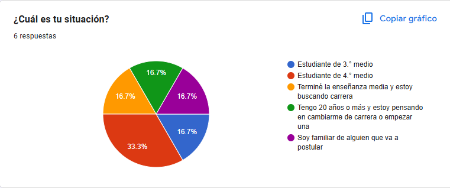

**¿Has considerado estudiar Ingeniería en Informática o una carrera parecida?**

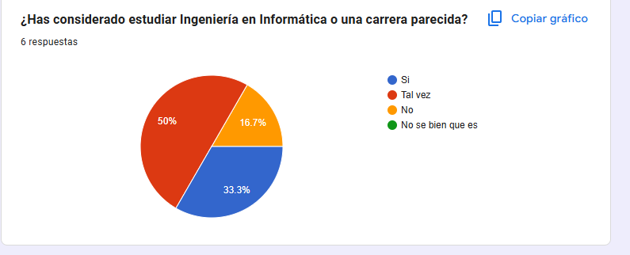

**¿Qué te gustaría saber de una carrera antes de postular?**

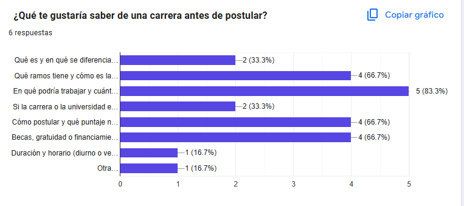

**De la lista anterior, ¿cuál es la más importante para ti?**

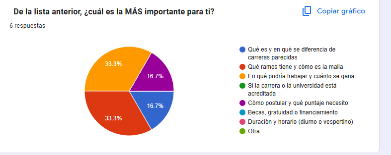

**¿Qué dudas o miedos tienes sobre estudiar Informática?** (respuesta abierta)

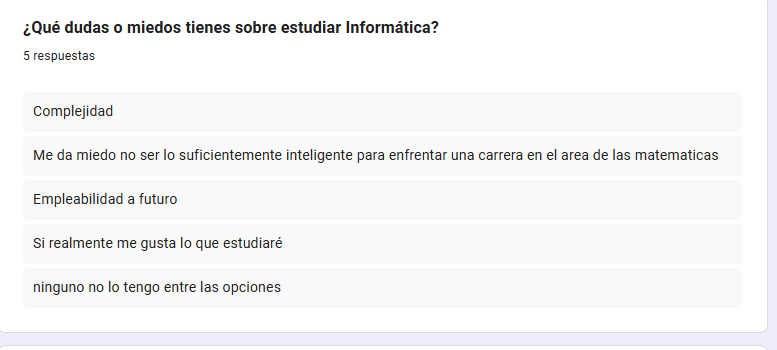

**¿Qué podría frenarte de postular?**

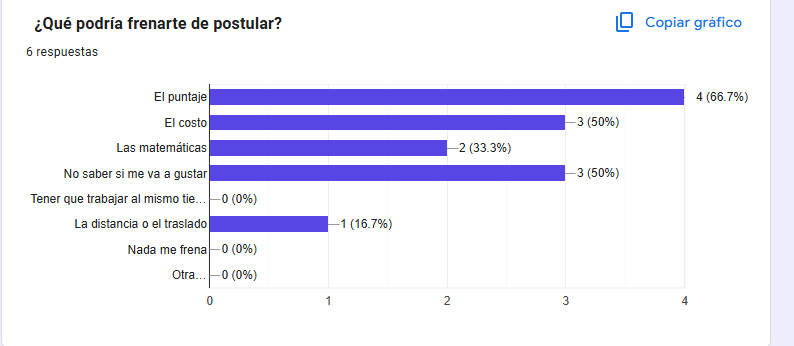

**¿Dónde buscas información sobre carreras y desde qué dispositivo?**

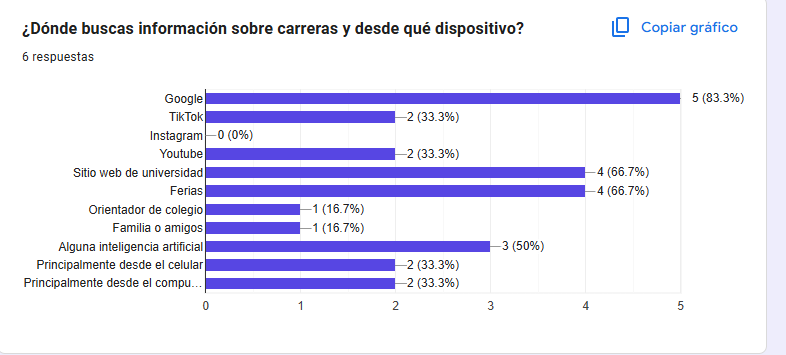

Las opciones "Tener que trabajar al mismo tiempo", "Nada me frena", "Otra" (en barreras) e "Instagram" no recibieron votos.

**Respuestas individuales:** el archivo original exportado de Google Forms (CSV) se conserva para que el profesor lo revise. No se publica en el repositorio, porque contiene nombres.

## Anexo C — Wireframes

Ver la sección 4.2 y los archivos `docs/wireframe-movil.png` y `docs/wireframe-escritorio.png`.

## Anexo D — Testimonios

Los testimonios del sitio (T01 a T12, en `src/content/testimonios.json`) son la experiencia real de los dos integrantes del equipo, que también son los autores del sitio. Ambos autorizaron por escrito publicarlos con su nombre ("Sí, autorizo publicar mi testimonio con mi nombre", 13-11-2026). En el sitio aparecen marcados como "Opinión personal". Solo se corrigió la ortografía y la puntuación.

## Anexo E — Declaración de uso de inteligencia artificial

**Herramienta:** Claude (Anthropic), usada como asistente durante todo el proyecto, en una sola conversación.

**Instrucción (prompt) consolidada.** Durante el trabajo dimos muchas instrucciones cortas, una por fase. Este es un resumen de todas ellas en un solo prompt:

> Somos dos estudiantes de Ingeniería en Informática de la UTEM y tenemos que hacer una landing page de nuestra carrera con Astro, según la propuesta del ramo Computación Móvil que adjuntamos. Explícanos qué hay que hacer y guíanos paso a paso por las fases A a E: fuentes, audiencia, arquitectura de información, redacción y validación. Busca fuentes oficiales y vigentes y arma la matriz en APA 7. Propón un cuestionario para Google Forms y analiza las respuestas que te enviemos. Redacta los textos del sitio en lenguaje claro, con cada dato citado y separando dato oficial, interpretación del equipo y opinión. Genera los wireframes en SVG. Escribe el código en Astro con TypeScript estricto, colecciones de contenido con esquema, CSS propio y una sola isla interactiva. No inventes datos: todo tiene que salir de una fuente que podamos revisar.

**Para qué la usamos y qué hicimos nosotros:**

| Tarea | Qué modificamos o verificamos nosotros |
|---|---|
| Entender el encargo y planificar las fases | |
| Buscar fuentes y armar el borrador de la matriz en APA 7 | Abrimos cada enlace, buscamos nosotros los datos de Mi Futuro (UTEM y Duoc) y detectamos que la malla se actualizó en 2026 |
| Proponer el cuestionario y analizar las respuestas | Armamos y aplicamos nuestro propio formulario, y revisamos el análisis |
| Redactar los textos del sitio a partir de las fuentes | Aportamos los testimonios con nuestras palabras y revisamos los textos |
| Generar los wireframes en SVG | Revisamos que coincidieran con el mapa de contenidos |
| Escribir el código del sitio y documentarlo con comentarios | Lo ejecutamos en nuestros computadores, comprobamos que el build pasara las reglas de los esquemas y lo publicamos en Netlify |
| Borrador del README y de este informe | Revisamos los borradores y pedimos cambios: sacamos partes que sobraban, ajustamos el formato y agregamos los gráficos de nuestra encuesta |

Ningún dato del sitio proviene solo de la IA: cada cifra se verificó en su fuente primaria, y lo que se cita es esa fuente, no la herramienta.

## Anexo F — Anexo técnico

- **Comandos:** `npm install`, `npm run dev`, `npm run build`, `npm run check` (ver README).
- **Reglas de los esquemas** (`src/content.config.ts`):
  - toda cita debe existir en `referencias.json`;
  - los textos publicados no pueden estar vacíos ni contener `TODO`;
  - las cifras deben traer un año de 4 dígitos;
  - las ponderaciones deben sumar 100 %;
  - las fechas de consulta deben tener el formato AAAA-MM-DD.
- **Código documentado:** cada archivo de `src/` comienza con un comentario que explica su propósito y sus decisiones, y las líneas importantes tienen su propio comentario.
